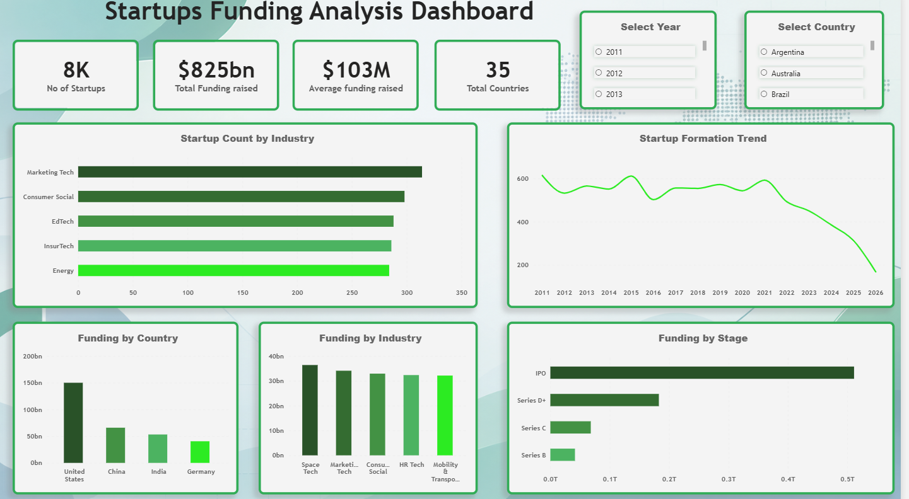

# Startup Funding Analysis

An end-to-end data analytics project focused on understanding global startup funding patterns across industries, funding stages, countries, and years.

The project uses Python for data preparation and exploration, SQL for data analysis, and Power BI to build an interactive dashboard.

## Dashboard



## Key Metrics

| Metric | Value |
|---|---:|
| Startups Analyzed | 8K |
| Total Funding Raised | $825B |
| Average Funding per Startup | $103M |
| Countries Covered | 35 |

## Analysis

The analysis focuses on five key areas:

- **Startup Formation** — How startup creation has changed over the years
- **Industry Distribution** — Which industries have the highest number of startups
- **Industry Funding** — Which industries have attracted the most funding
- **Funding Stages** — How funding is distributed across different funding stages
- **Geographic Funding** — How startup funding varies across countries

## Dashboard Features

The Power BI dashboard provides interactive analysis through:

- Startup Count by Industry
- Startup Formation Trend
- Funding by Country
- Funding by Industry
- Funding by Stage
- Year filter
- Country filter
- KPI cards for key metrics

## Tech Stack

**Python**
- Pandas
- Jupyter Notebook

**Database**
- MySQL
- SQL

**Visualization**
- Power BI

## Project Workflow

```text
Raw Dataset
     ↓
Python Data Exploration & Preparation
     ↓
MySQL Database
     ↓
SQL Analysis
     ↓
Power BI Dashboard
     ↓
Interactive Insights